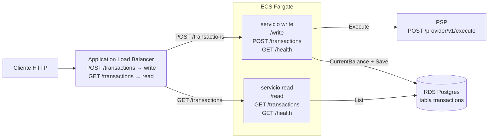
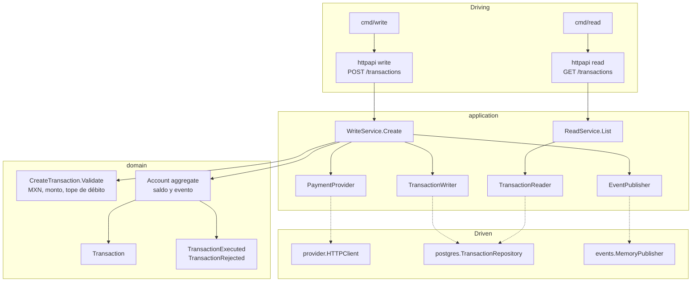
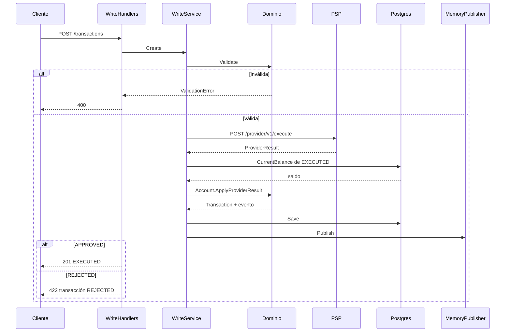

# spin-transactions

Este proyecto consiste en una API REST que soporta operaciones de CREDIT y DEBIT; y lista de operaciones.

## Arquitectura de sistema

Un cliente HTTP entra por un Application Load Balancer. `POST /transactions` va al servicio de escritura y `GET /transactions` al de lectura. Cada uno es un servicio ECS con su task definition, su health check y su escalado. Los dos salen de la misma imagen; el comando del task es `/write` o `/read`.



| Servicio | Rutas | Sale hacia |
|---|---|---|
| write | `POST /transactions`, `GET /health` | PSP y Postgres |
| read | `GET /transactions`, `GET /health` | solo Postgres |

Comparten la base. La escritura inserta la fila (`EXECUTED` o `REJECTED`) y el saldo es la suma de transacciones `EXECUTED` de esa cuenta. La lectura pagina esa misma tabla. No hay un modelo de lectura distinto ni una réplica.

`MemoryPublisher` vive dentro del task de escritura y deja el evento en el log de ese proceso. No hay un bus entre los dos servicios.

El health check del target group pega directo al task en `GET /health`. El ALB no publica esa ruta: solo enruta `/transactions`.

**Alta.** `POST /transactions` llega al servicio write: validar, llamar al PSP, leer el saldo, aplicar el aggregate, guardar y publicar el evento. Responde `201` si quedó `EXECUTED`, `422` si el proveedor rechazó (la fila igual se guarda), `400` si la validación falla y `502` si falla la infraestructura. El servicio read no participa.

**Listado.** `GET /transactions` llega al servicio read. Ejecuta `ReadService.List` contra Postgres y responde `200` con `data`, `page`, `limit` y `total`. No llama al PSP ni toca el aggregate.

## Arquitectura de código

Las dependencias apuntan hacia adentro. Dominio y aplicación no importan Gin, `database/sql` ni `net/http`. El HTTP de entrada solo conoce su servicio de aplicación. Los adapters driven implementan los puertos.



| Capa | Qué decide |
|---|---|
| `cmd/write`, `cmd/read` | Proceso. Write escucha en `:8080`, read en `:8081`, salvo que exista `HTTP_ADDR`. |
| `internal/bootstrap` | Composition root. `NewWriteRouter` cablea proveedor, repositorio y publisher, y corre migraciones. `NewReadRouter` cablea solo el repositorio. |
| `httpapi` | Traduce JSON y códigos HTTP. |
| `WriteService` | Orquesta el alta. No elige el evento ni la regla de saldo. |
| `ReadService` | Delega el listado en `TransactionReader`. |
| `domain/account` | Aggregate root. Aplica el resultado del proveedor, mueve el saldo y emite el evento. |
| `domain/transaction` | Entidad, policy (`Validate`) y el lenguaje del proveedor (`ProviderResult`). |
| Puertos | `PaymentProvider`, `TransactionWriter` (`Save`, `CurrentBalance`), `TransactionReader` (`List`), `EventPublisher`. |

`postgres.TransactionRepository` implementa los dos puertos de persistencia porque write y read comparten la tabla. El adapter del PSP solo lo usa write.



1. El handler arma `CreateTransaction` desde el JSON.
2. `Validate` exige tipo `CREDIT` o `DEBIT`, moneda `MXN`, monto mayor a `1.00` y débito de hasta `10000.00`. Si falla, responde `400` y no llama al proveedor.
3. `HTTPClient` llama a `POST {PROVIDER_BASE_URL}/provider/v1/execute` con `X-API-Key`. `200`/`201` se traducen a aprobado y `4xx` a rechazo de negocio. Un fallo de red o un status inesperado sube como error y el handler responde `502`.
4. El saldo actual es la suma de transacciones `EXECUTED` de esa cuenta: crédito suma, débito resta.
5. `Account.ApplyProviderResult` crea la `Transaction`. Si el proveedor aprobó, pone `EXECUTED`, suma o resta el monto y emite `TransactionExecuted`. Si rechazó, pone `REJECTED`, no mueve el saldo y emite `TransactionRejected`.
6. Se guarda siempre, también el rechazo. Después se publica el evento. El error de publicación se ignora.
7. `EXECUTED` vuelve como `201`. `REJECTED` vuelve como `422` con la transacción ya persistida, más `code` y `message` del proveedor.

`GET /transactions` no toca dominio ni proveedor. El handler arma un `ListFilter` (`accountId`, `status`, `type`, `page`, `limit`; default 1 y 20, tope 100) y `ReadService.List` delega en el repositorio, que pagina por `created_at` descendente.

## Contrato

- `POST /transactions` — servicio write: validar → proveedor → persistir → `201` / `422`
- `GET /transactions` — servicio read: listado paginado desde Postgres
- `GET /health` — en cada proceso

Escritura: `PROVIDER_BASE_URL`, `PROVIDER_API_KEY`, `DATABASE_URL` o `DB_*`, `RUN_MIGRATIONS`, `HTTP_ADDR` (default `:8080`).

Lectura: `DATABASE_URL` o `DB_*`, `HTTP_ADDR` (default `:8081`). No llama al proveedor y no corre migraciones.

Un solo comando levanta Postgres en Docker y los dos procesos. Si no existe `.env`, lo copia desde `.env.example`. Postgres queda en `localhost:5432` (usuario `txadmin`, base `transactions`). Write escucha en `:8080` y read en `:8081`. Ese contenedor no se usa en AWS.

```bash
make local
```

Ctrl-C detiene write y read. `make db-down` apaga Postgres y conserva el volumen. `make db-reset` borra ese volumen y vuelve a levantar Postgres vacío; la tabla se crea otra vez cuando arranca write.

`godotenv` no pisa variables que ya vienen del entorno. Si `.env` define `HTTP_ADDR`, los dos procesos lo usan; para separarlos en local, no lo pongas en `.env`.

## AWS

Un solo comando crea el stack, publica la imagen en ECR y deja los dos servicios ECS arriba. Si el stack aún no existe, primero despliega la red, RDS, ECR y el ALB, y después los servicios. Hace falta AWS CLI, SAM CLI, Docker y una región (`AWS_REGION` o el perfil de AWS).

El stack crea recursos con costo (RDS `db.t4g.micro`, dos tasks Fargate, un ALB). El nombre es `spin-transactions` (minúsculas: se usa como identificador de RDS y como repositorio ECR). `PROVIDER_BASE_URL` y `PROVIDER_API_KEY` salen de `.env` si existe.

```bash
make deploy
```

Write corre las migraciones (`RUN_MIGRATIONS=true`). La contraseña de RDS la administra el propio RDS y entra al task como secreto. Cada task ejecuta `/write` o `/read` (linux/arm64). Al terminar imprime la URL del ALB.

## Tests

```bash
go test ./... -count=1
```

`WriteService`, `ReadService` y el aggregate se prueban con stubs de los puertos, sin Gin ni Postgres.
